# Bildung in Deutschland 2006 bis 2026: Was 20 Jahre Bildungsbericht sagen

**20 Jahre Bildungsbericht in fünf Befunden:** Der Bericht ist überwiegend beschreibend angelegt. Seine Themen verschieben sich von Strukturen zu Lebenslagen. Fünf Herausforderungen benennt er seit 2006 wiederholt. Zur häufigsten, der Steuerung des Bildungssystems, gibt es bisher keine Tabelle mit passendem Titel. Von Bericht zu Bericht wird rund die Hälfte der Tabellen neu aufgenommen.

  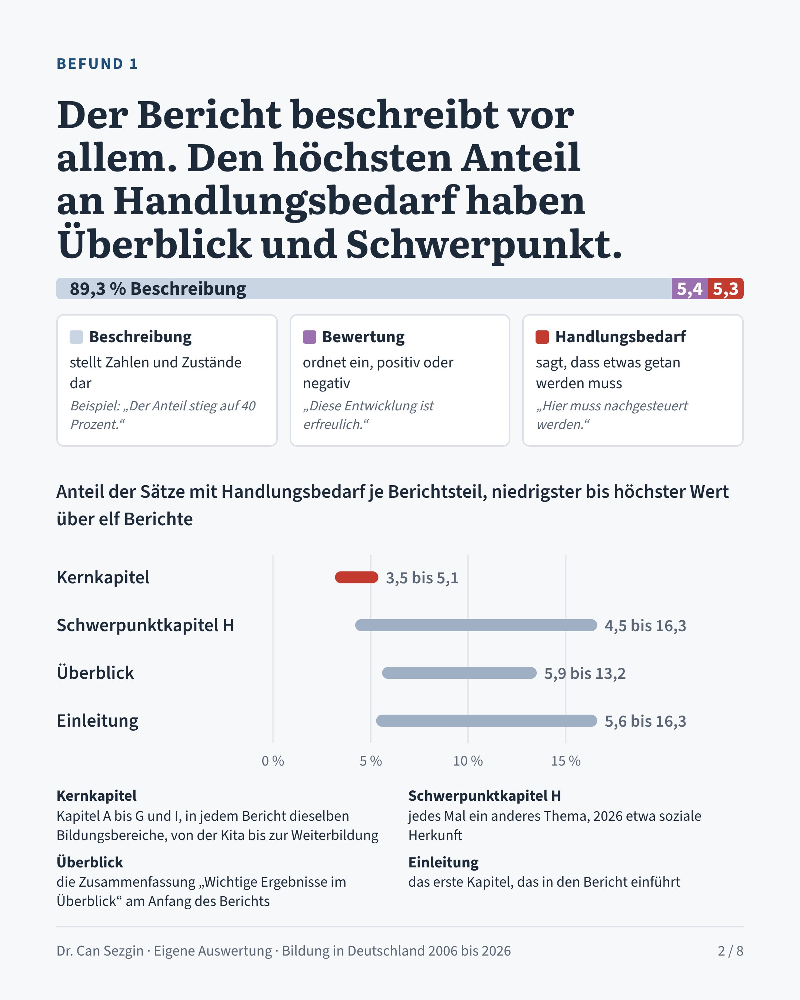
  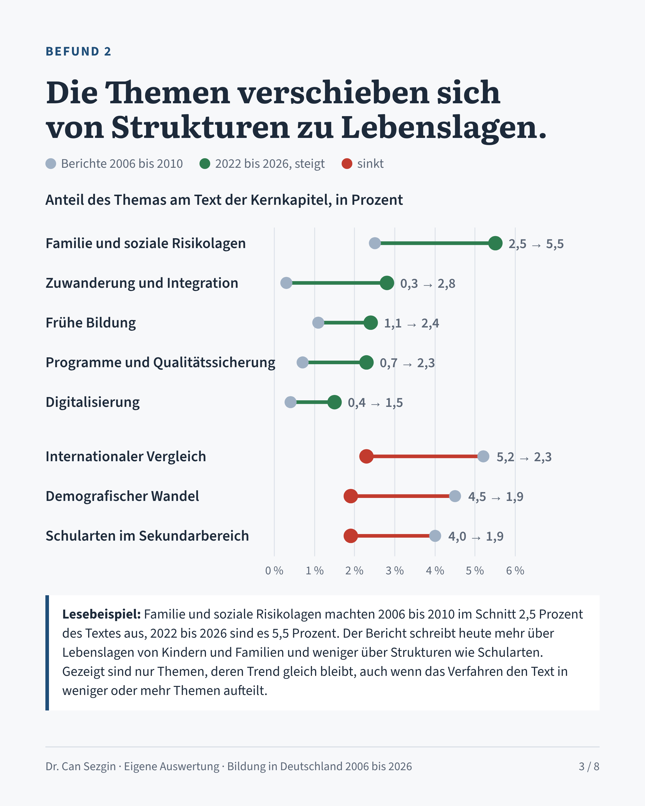

  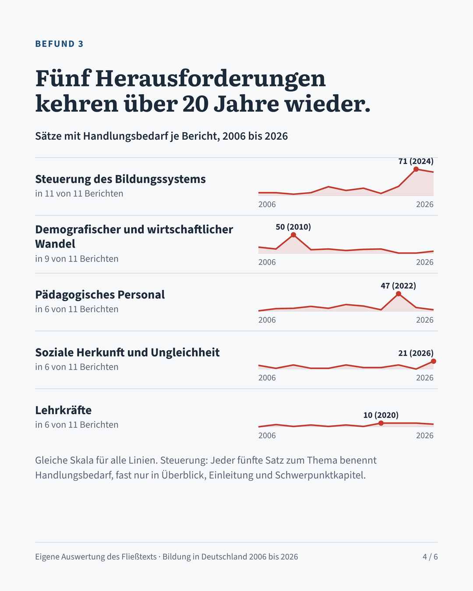
  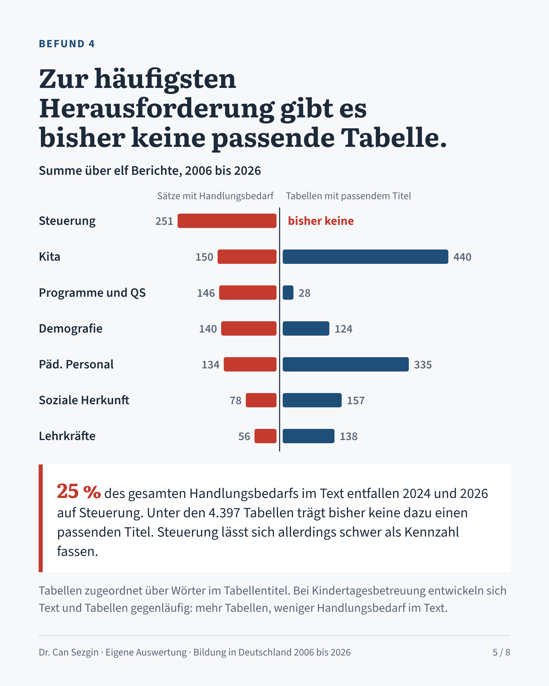

  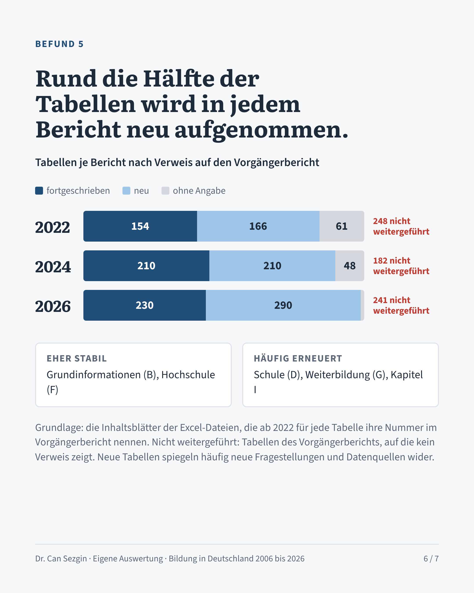
  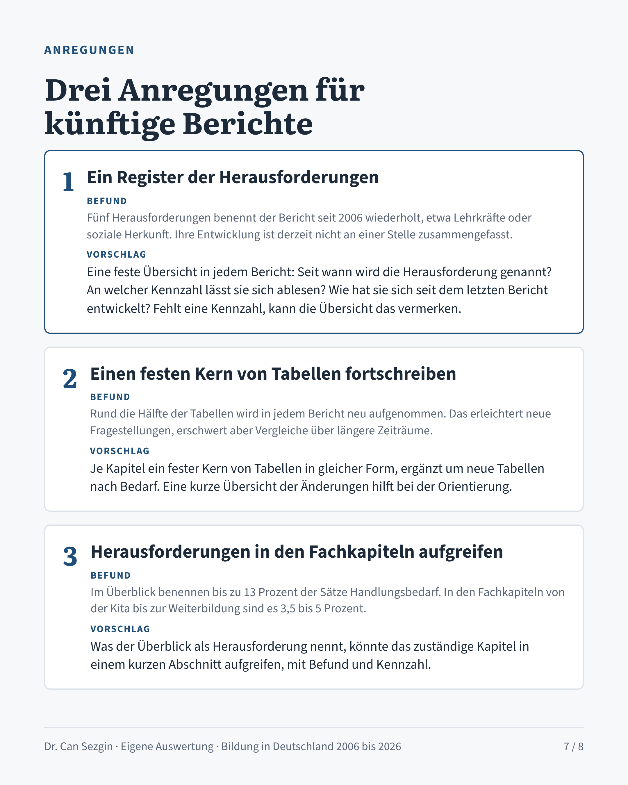

Alle acht Folien als PDF: [figures/social/bildungsbericht_karussell.pdf](figures/social/bildungsbericht_karussell.pdf)

Die nationalen Bildungsberichte "Bildung in Deutschland" haben großen Einfluss auf die Bildungspolitik und greifen seit 2006 in gleichbleibender Struktur die Themen des Bildungswesens auf. Damit bilden sie einen sehr gut geeigneten Datensatz, um Methoden der Computational Social Science anzuwenden. Dieses Projekt ist in diesem Sinne entstanden: als methodische Übung an einem Material, dessen inhaltliche Einordnung bei den Fachleuten der Bildungsforschung liegt.

Die Analyse wertet die elf Berichte von 2006 bis 2026 aus, den Fließtext und den Bestand an Excel-Tabellen. Sie fragt, welche Themen der Bericht über 20 Jahre setzt, wie er beschreibt, bewertet oder Handlungsbedarf benennt, zu welchen Themen er wiederholt Handlungsbedarf sieht und ob es dazu passende Tabellen gibt. Im Mittelpunkt stehen Inhalte, nicht Formulierungen oder Stil. Die Ergebnisse sind als Angebot zur Diskussion gedacht, nicht als Bewertung der Berichte.

## Auf einen Blick

- **Der Bericht ist überwiegend beschreibend angelegt.** Das entspricht seinem Auftrag als indikatorengestützter Bericht. Rund 89 Prozent der Sätze beschreiben, je rund 5 Prozent bewerten oder benennen Handlungsbedarf. Daran ändert sich in 20 Jahren wenig.
- **Der Anteil an Handlungsbedarf ist im Überblick, in der Einleitung und im Schwerpunktkapitel am höchsten.** In den Kernkapiteln¹ liegt er stabil bei 3,5 bis 5,1 Prozent der Sätze, im Überblick zeitweise bei 12 bis 13 Prozent.
- **Die Themen verschieben sich von Strukturen zu Lebenslagen.** Zuwanderung, Familie und soziale Risikolagen, frühe Bildung, Digitalisierung sowie Programme und Qualitätssicherung gewinnen an Gewicht. Internationaler Vergleich, demografischer Wandel, Schularten und Ausbildungsberufe verlieren.
- **Fünf Herausforderungen benennt der Bericht wiederholt, und dieser Befund hält allen Prüfungen stand:** Steuerung des Bildungssystems, demografischer und wirtschaftlicher Wandel, pädagogisches Personal, soziale Herkunft und Ungleichheit sowie Lehrkräfte.
- **Text und Tabellen setzen unterschiedliche Schwerpunkte.** Zur Steuerung des Bildungssystems benennt der Text 251 Sätze mit Handlungsbedarf, unter den 4.397 Tabellen trägt bisher keine einen passenden Titel. Steuerung ist allerdings ein Thema, das sich schwer als Kennzahl fassen lässt. Zur Kindertagesbetreuung gibt es 440 Tabellen, während der Handlungsbedarf im Text zurückgeht.
- **Der Tabellenbestand erneuert sich stark.** Von 2024 zu 2026 schreibt der Bericht 230 Tabellen fort, nimmt 290 neu auf und führt 241 nicht weiter.

¹ Kernkapitel: die Kapitel A bis G und I, die in jedem Bericht dieselben Bildungsbereiche behandeln. Details im Abschnitt "Kapitelgruppen".

## Fragen

1. Welche Themen bleiben über 20 Jahre konstant, welche kommen hinzu, welche gehen zurück?
2. Welche Herausforderungen benennt der Bericht wiederholt, und wie entwickeln sich die zugehörigen Indikatoren im selben Zeitraum?
3. Wie verteilen sich Beschreibung, Bewertung und Handlungsbedarf im Text?

Alle drei Fragen sind beantwortet. Frage 2 hat zwei Teile: die wiederkehrenden Herausforderungen im Text und ihr Abgleich mit den Tabellen.

## Datengrundlage

| Quelle | Umfang | Verwendung |
|---|---|---|
| Fließtext der elf Vollberichte, von der Einleitung bis vor das Literaturverzeichnis | 9.188 Absätze (9.125 im Topic Model), 41.314 Sätze mit mindestens fünf Wörtern | Themen, Einordnung der Sätze, wiederkehrende Herausforderungen |
| Excel-Tabellen der elf Berichte von bildungsbericht.de | 452 Dateien, 4.891 Blätter, davon 4.397 Tabellen und 449 Abbildungen | Fortschreibung, Abgleich mit dem Text |

Die Tabellen gehen nur über ihre Nummer, ihren Titel und die Inhaltsblätter ein. Die Werte in den Tabellen wertet die Analyse nicht aus, mit Ausnahme von sechs Leitindikatoren (Abbildung 16). Die Berichte und Tabellen sind auf [bildungsbericht.de](https://www.bildungsbericht.de) frei verfügbar. Dieses Repository enthält keine Texte, Tabellentitel oder Tabellen aus den Berichten, nur eigene Auswertungen.

## Vorgehen

| Schritt | Verfahren | Frage |
|---|---|---|
| Themen finden | Structural Topic Model mit 40 Themen, Absatz als Einheit, Jahr und Kapitel als Kovariaten | 1 |
| Themen vergleichen | Anteil je Thema in den Berichten 2006 bis 2010 und 2022 bis 2026, geprüft mit Modellen mit 30 und 60 Themen | 1 |
| Sätze einordnen | Wörterbuch mit Signalwörtern: Beschreibung, Bewertung, Handlungsbedarf | 3 |
| Herausforderungen finden | Themen, zu denen in mindestens 6 der 11 Berichte überdurchschnittlich oft Handlungsbedarf steht | 2 |
| Robustheit | strenge Wortliste ohne Modalverben, Zählung nur in Kernkapiteln, Modell ohne Signalwörter | 2, 3 |
| Tabellen erfassen | alle Excel-Dateien laden, jedes Blatt als Tabelle, Abbildung oder Sonstiges einordnen, Inhaltsblatt und Blätter abgleichen | 2 |
| Fortschreibung messen | Verweis auf die Nummer im Vorgängerbericht, den die Inhaltsblätter ab 2022 nennen | 2 |
| Text und Tabellen abgleichen | Tabellen über Wörter im Titel den Herausforderungen zuordnen, Anteil im Text und in den Tabellen je Bericht vergleichen (Spearman) | 2 |
| Leitindikatoren | je Herausforderung die längste Zeitreihe aus den Tabellen 2026, Zeile Deutschland insgesamt, ohne Vorausberechnungen | 2 |

### Kapitelgruppen

Jeder Bericht hat einen festen und einen wechselnden Teil. Die Analyse betrachtet sie getrennt, weil der wechselnde Teil die Jahreswerte überlagert: Ein Thema kann in einem Jahr stark steigen, weil das Schwerpunktkapitel davon handelt.

| Gruppe | Kapitel | Inhalt |
|---|---|---|
| Kernkapitel | A Rahmenbedingungen, B Grundinformationen, C Frühe Bildung, D Allgemeinbildende Schule, E Berufliche Ausbildung, F Hochschule, G Weiterbildung, I Wirkungen und Erträge | behandeln in jedem Bericht dieselben Bildungsbereiche |
| Schwerpunktkapitel | H | wechselt das Thema mit jedem Bericht, 2010 etwa demografischer Wandel, 2026 soziale Herkunft |
| Überblick | Wichtige Ergebnisse im Überblick | fasst zusammen, 2026 erstmals mit "Zentralen Herausforderungen" |
| Einleitung | Einleitung | führt in den Bericht ein |

"Kernkapitel" ist ein Arbeitsbegriff dieser Analyse, kein Begriff der Berichte. 2018 fehlt Kapitel I, weil das Schwerpunktkapitel H selbst Wirkungen und Erträge behandelt.

## Ergebnisse

### Frage 1: Welche Themen bleiben, kommen hinzu, gehen zurück?

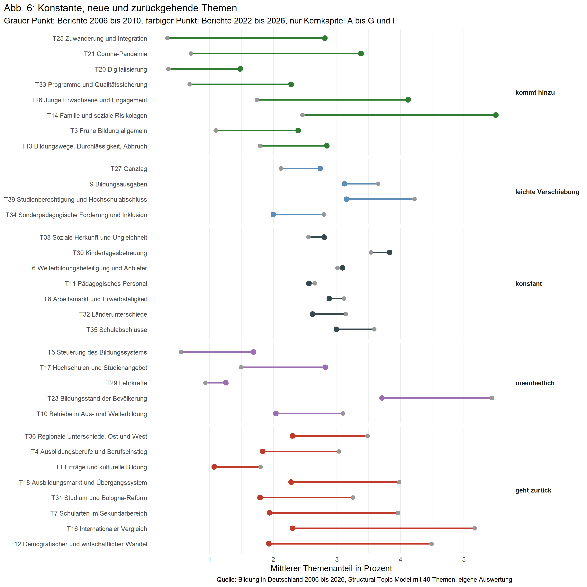

Nur Kernkapitel A bis G und I. Grauer Punkt: Durchschnitt der Berichte 2006 bis 2010, farbiger Punkt: 2022 bis 2026.

- Von 32 inhaltlichen Themen kommen in den Kernkapiteln 8 hinzu, 8 gehen zurück, 7 bleiben konstant, 4 verschieben sich leicht und 5 verändern sich uneinheitlich.
- Am stärksten wachsen Zuwanderung und Integration (0,3 auf 2,8 Prozent) sowie Familie und soziale Risikolagen (2,5 auf 5,5 Prozent).
- Am stärksten sinken internationaler Vergleich (5,2 auf 2,3 Prozent) und demografischer Wandel (4,5 auf 1,9 Prozent).
- Soziale Herkunft bleibt in den Kernkapiteln auf gleichem Niveau (2,6 und 2,8 Prozent). Die Spitzen 2006 und 2026 stammen aus den Schwerpunktkapiteln.
- In allen vergleichbaren Modellen mit 30, 40 und 60 Themen bleibt die Richtung gleich: Es steigen Digitalisierung, Programme und Qualitätssicherung, Familie und soziale Risikolagen, Zuwanderung, frühe Bildung, Ganztag und Lehrkräfte. Es sinken internationaler Vergleich, demografischer Wandel, Schularten, Ausbildungsberufe, Betriebe in Aus- und Weiterbildung, Erträge und kulturelle Bildung, regionale Unterschiede sowie Studienberechtigung und Hochschulabschluss.

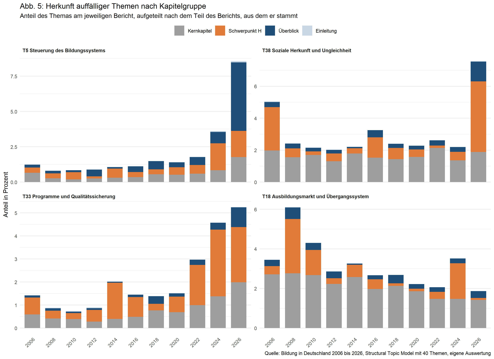

Kernkapitel: A bis G und I. Schwerpunkt H: wechselndes Thema je Bericht.

Der starke Anstieg von Steuerung des Bildungssystems 2026 (8,6 Prozent) stammt vor allem aus dem Überblick (rund 4,9 Prozentpunkte). In den Kernkapiteln steigt das Thema nur wenig, und die Vergleichsmodelle bestätigen diesen Anstieg nicht.

### Frage 3: Beschreibung, Bewertung, Handlungsbedarf

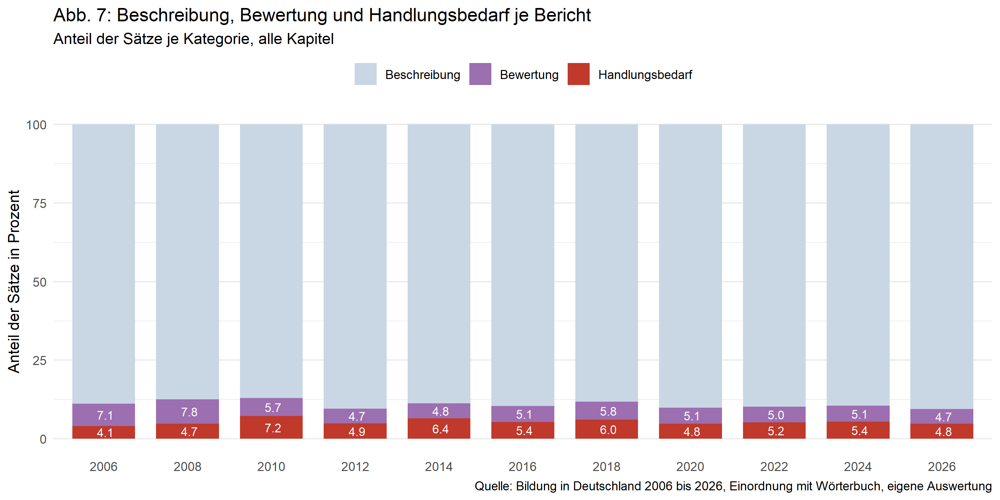

Der Anteil der beschreibenden Sätze liegt in allen Berichten bei rund 87 bis 91 Prozent. Bewertung (4,7 bis 7,8 Prozent) und Handlungsbedarf (4,1 bis 7,2 Prozent) zeigen keinen Trend.

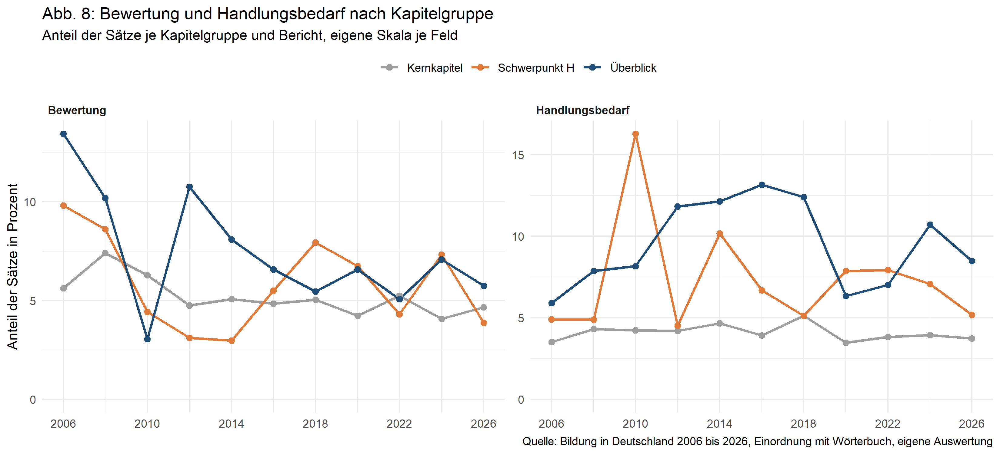

Kernkapitel: A bis G und I. Die Einleitung fehlt, weil sie je Bericht nur 12 bis 34 Absätze umfasst.

Die Kapitelgruppen unterscheiden sich deutlich. In den Kernkapiteln bleibt der Anteil an Handlungsbedarf bei 3,5 bis 5,1 Prozent. Im Überblick erreicht er 2012 bis 2018 rund 12 bis 13 Prozent, im Schwerpunktkapitel 2010 (demografischer Wandel) 16,3 Prozent.

### Frage 2, Teil 1: Welche Herausforderungen benennt der Bericht wiederholt?

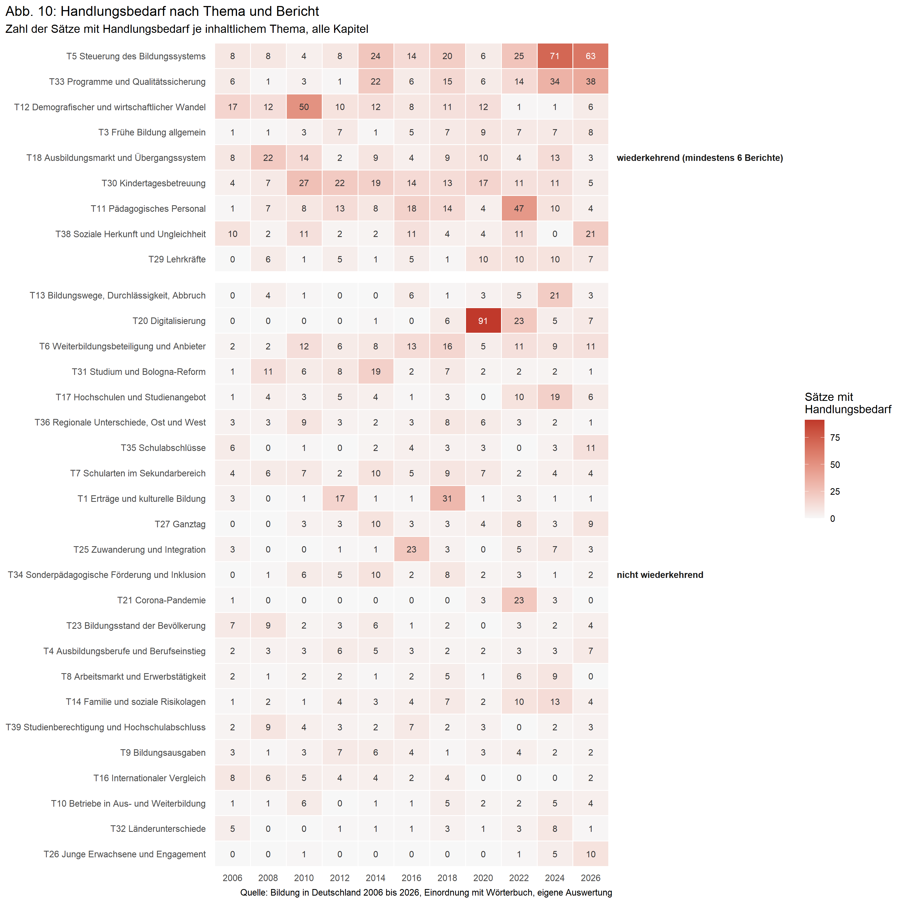

Zahl der Sätze mit Handlungsbedarf je Thema und Bericht, alle Kapitel. Oberer Block: wiederkehrend nach der Hauptregel.

Ein Thema gilt als wiederkehrend, wenn der Bericht dazu in mindestens 6 der 11 Berichte mindestens 3 Sätze mit Handlungsbedarf schreibt und dieser Anteil über dem des ganzen Berichts liegt. Nach den Robustheitsprüfungen ergeben sich drei Stufen:

| Stufe | Themen |
|---|---|
| belastbar | Steuerung des Bildungssystems, demografischer und wirtschaftlicher Wandel, pädagogisches Personal, soziale Herkunft und Ungleichheit, Lehrkräfte |
| mit Einschränkung | Kindertagesbetreuung (hängt an Modalverben wie "müssen") |
| modellabhängig | Programme und Qualitätssicherung, Ausbildungsmarkt und Übergangssystem, frühe Bildung |

- Steuerung des Bildungssystems hat mit 20 Prozent die höchste Quote: Jeder fünfte Satz zu diesem Thema benennt Handlungsbedarf, in allen 11 Berichten überdurchschnittlich. Auch im Modell ohne Signalwörter bleibt das so (17,4 Prozent). Der Handlungsbedarf steigt von 4 bis 8 Sätzen bis 2012 auf 71 Sätze 2024 und 63 Sätze 2026. Er steht überwiegend im Überblick, in der Einleitung und im Schwerpunktkapitel.
- Zum demografischen Wandel benennt der Bericht 2010 noch 50 Sätze mit Handlungsbedarf, 2022 und 2024 je einen.
- Zu Bildungsstand, Studienberechtigung, Bildungsausgaben und internationalem Vergleich benennt der Fließtext kaum Handlungsbedarf (Quote unter 3 Prozent).

### Werden die Tabellen von Bericht zu Bericht fortgeschrieben?

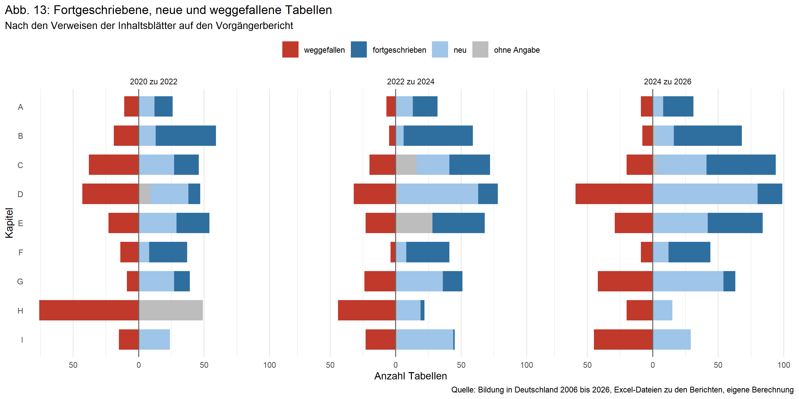

Grundlage: die Inhaltsblätter der Excel-Dateien, die seit 2022 für jede Tabelle ihre Nummer im Vorgängerbericht nennen. Nicht weitergeführt: Tabellen des Vorgängerberichts, auf die kein Verweis zeigt.

| Übergang | fortgeschrieben | neu | ohne Angabe | nicht weitergeführt |
|---|---|---|---|---|
| 2020 zu 2022 | 154 | 166 | 61 | 248 |
| 2022 zu 2024 | 210 | 210 | 48 | 182 |
| 2024 zu 2026 | 230 | 290 | 7 | 241 |

- Von den Tabellen mit Angabe schreibt jeder Bericht 44 bis 50 Prozent fort, die übrigen nimmt er neu auf. Neue Tabellen spiegeln häufig neue Fragestellungen und Datenquellen wider.
- Die Kapitel B (Grundinformationen) und F (Hochschule) schreiben überwiegend fort. In D (Schule), G (Weiterbildung) und I überwiegen neu aufgenommene Tabellen.
- Vor 2022 nennen die Inhaltsblätter keinen Vorgänger. Für diese Berichte lässt sich die Fortschreibung nicht messen.

### Frage 2, Teil 2: Gibt es zu den Herausforderungen passende Tabellen?

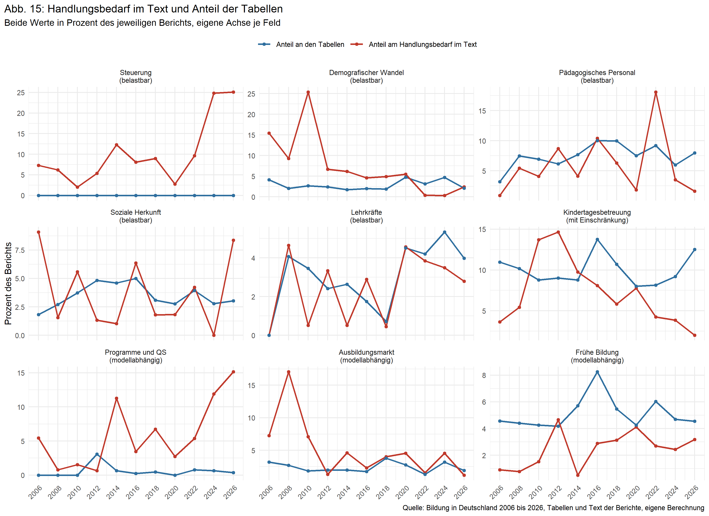

Anteil der Herausforderung am Handlungsbedarf im Text und an den Tabellen je Bericht. Tabellen zugeordnet über Wörter im Tabellentitel.

1.371 der 4.397 Tabellen (31 Prozent) lassen sich über ihren Titel mindestens einer der neun Herausforderungen zuordnen.

| Herausforderung | Sätze mit Handlungsbedarf | Tabellen | Spearman Text zu Tabellen |
|---|---|---|---|
| Steuerung des Bildungssystems | 251 | 0 | nicht berechenbar |
| Kindertagesbetreuung | 150 | 440 | −0,38 |
| Programme und Qualitätssicherung | 146 | 28 | 0,21 |
| demografischer und wirtschaftlicher Wandel | 140 | 124 | −0,08 |
| pädagogisches Personal | 134 | 335 | 0,55 |
| soziale Herkunft und Ungleichheit | 78 | 157 | −0,15 |
| Ausbildungsmarkt und Übergangssystem | 98 | 104 | 0,33 |
| Lehrkräfte | 56 | 138 | 0,77 |
| frühe Bildung | 56 | 226 | −0,28 |

Summen über elf Berichte, alle Kapitel. Spearman: Rangkorrelation der Anteile im Text und in den Tabellen über die elf Berichte.

- Steuerung ist die häufigste Herausforderung im Text, 2024 und 2026 mit rund einem Viertel des gesamten Handlungsbedarfs. Bisher trägt keine Tabelle dazu einen passenden Titel. Das Thema beschreibt das Zusammenwirken von Akteuren und Institutionen und lässt sich nur schwer in einer einzelnen Kennzahl abbilden.
- Programme und Qualitätssicherung macht 2026 rund 15 Prozent des Handlungsbedarfs im Schwerpunktkapitel aus und 0,4 Prozent der Tabellen.
- Bei Lehrkräften (0,77) und pädagogischem Personal (0,55) entwickeln sich Text und Tabellen gleichläufig. Zu Lehrkräften gibt es 2006 keine Tabelle, 2024 sind es 25.
- Bei Kindertagesbetreuung entwickeln sie sich gegenläufig: Die Tabellen machen 2026 12,5 Prozent des Bestands aus, während der Handlungsbedarf im Text zurückgeht. Das passt zum Ausbau der Kindertagesbetreuung, den die Tabellen dokumentieren.

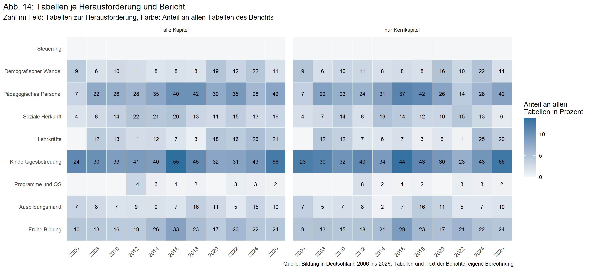

Zahl der Tabellen je Herausforderung und Bericht, alle Kapitel.

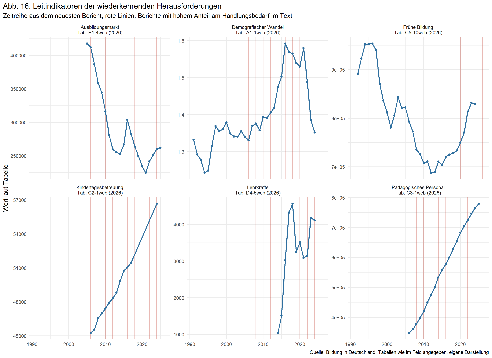

Je Herausforderung die längste Zeitreihe aus den Tabellen des Berichts 2026, Zeile Deutschland insgesamt, ohne Vorausberechnungen. Quelle je Reihe: Tabellennummer im Bericht 2026. Werte gerundet.

| Herausforderung | Tabelle 2026 | Entwicklung |
|---|---|---|
| demografischer Wandel | A1-1web | zusammengefasste Geburtenziffer 1,24 (1994), 1,59 (2016), 1,35 (2024) |
| pädagogisches Personal | C3-1web | Personal in Kitas von rund 350.000 (2006) auf rund 780.000 (2025) |
| Lehrkräfte | D4-5web | Neueinstellungen ohne Lehramtsprüfung von rund 1.000 (2014/15) auf rund 4.600 (2018/19), danach 3.100 bis 4.200 |
| Kindertagesbetreuung | C2-1web | Kitas ohne Horte von rund 45.300 (2006) auf 56.700 (2024), Lücke 2018 bis 2023 |
| Ausbildungsmarkt | E1-4web | Neuzugänge im Übergangssektor von rund 417.000 (2005) auf rund 225.000 (2021), 2025 rund 262.000 |
| frühe Bildung | C5-10web | Einschulungen: Höchststand rund 955.000 (1996), Tiefstand rund 687.000 (2012), 2023 rund 833.000 |

Für Steuerung, soziale Herkunft und Programme und Qualitätssicherung findet die Analyse keine Zeitreihe, die sich als Leitindikator eignet.

## Grenzen und offene Punkte

- **Keine Prüfung von Hand.** Die Einordnung der Sätze beruht auf einem Wörterbuch. Eine Stichprobe von 308 Sätzen für eine Prüfung von Hand ist vorbereitet, aber nicht codiert. Die Robustheitsprüfungen zeigen, welche Befunde stabil sind, nicht ob das Wörterbuch Handlungsbedarf richtig erkennt.
- **Modellabhängigkeit.** 14 der 32 Themen ändern ihre Richtung zwischen den Modellen mit 30, 40 und 60 Themen. Die Ergebnisse oben nennen nur die stabilen Befunde.
- **Selbst gesetzte Schwellen.** Die Regeln für "wiederkehrend" und für die fünf Muster sind festgelegt, nicht aus den Daten abgeleitet. Die Notebooks legen jede Schwelle offen.
- **Zuordnung der Tabellen über den Titel.** Eine Tabelle, deren Titel kein Suchwort enthält, fehlt in der Zählung, auch wenn sie zum Thema gehört. "Keine Tabelle zur Steuerung" heißt deshalb nur: kein Titel mit passendem Wort. Daten zum Thema können in anderen Tabellen enthalten sein.
- **Fortschreibung erst ab 2022 messbar.** Die Vorgängerspalte gibt es erst in den Inhaltsblättern ab 2022. 49 Zellen sind leer, sie zählen als "ohne Angabe".
- **Leitindikatoren gerundet.** Die Werte in Abbildung 16 und in der Tabelle oben sind gerundet. Die genauen Werte stehen in `data/processed/leitindikatoren.csv`.
- **Sprünge in der Gliederung.** Einige Rückgänge treten als Sprung zwischen zwei Berichten auf, etwa Schularten 2022. Sie können auf eine geänderte Gliederung zurückgehen statt auf eine geringere Bedeutung des Themas.
- **Blick von außen.** Die Analyse kennt die Abwägungen nicht, die hinter Gliederung, Themenwahl und Tabellenauswahl der Berichte stehen. Viele Befunde haben vermutlich gute fachliche Gründe.

## Anregungen für die Berichterstattung

Die folgenden Anregungen verstehen sich als Angebot aus methodischer Sicht. Sie betreffen die Form der Berichterstattung, nicht die Bildungspolitik, und beruhen jeweils auf einem der Befunde oben. Ob und wie sie sich umsetzen lassen, können die Autor:innengruppe und die beteiligten Institute am besten beurteilen.

| Nr. | Anregung | Befund | Vorschlag |
|---|---|---|---|
| 1 | Ein Register der Herausforderungen | Fünf Herausforderungen benennt der Bericht seit 2006 wiederholt, etwa Lehrkräfte oder soziale Herkunft. Ihre Entwicklung über mehrere Berichte ist derzeit nicht an einer Stelle zusammengefasst. | Eine feste Übersicht in jedem Bericht: Seit wann wird die Herausforderung genannt? An welcher Kennzahl lässt sie sich ablesen? Wie hat sich diese seit dem letzten Bericht entwickelt? Wo keine Kennzahl vorliegt, wie bei Steuerung, kann die Übersicht das vermerken. |
| 2 | Einen festen Kern von Tabellen fortschreiben | Rund die Hälfte der Tabellen wird in jedem Bericht neu aufgenommen. Von den 468 Tabellen des Berichts 2024 führt der Bericht 2026 241 nicht weiter. Das erleichtert neue Fragestellungen, erschwert aber Vergleiche über längere Zeiträume. | Je Kapitel ein fester Kern von Tabellen, den jeder Bericht in gleicher Form fortschreibt, ergänzt um neue Tabellen nach Bedarf. Eine kurze Übersicht der Änderungen hilft Lesenden bei der Orientierung. |
| 3 | Herausforderungen in den Fachkapiteln aufgreifen | Der Anteil an Handlungsbedarf ist im Überblick (bis zu 13,2 Prozent der Sätze) und in der Einleitung (bis zu 16,3 Prozent) am höchsten. In den Kapiteln zu Kita, Schule, Ausbildung, Hochschule und Weiterbildung sind es 3,5 bis 5,1 Prozent. | Was der Überblick als Herausforderung nennt, könnte das zuständige Kapitel in einem kurzen Abschnitt aufgreifen, mit Befund und Kennzahl. |
| 4 | Frühere Schwerpunkte nachverfolgen | Jeder Bericht hat ein Schwerpunktthema. Zum demografischen Wandel, Schwerpunkt 2010, stehen in jenem Bericht 50 Sätze mit Handlungsbedarf, 2022 und 2024 je einer. Zur Digitalisierung, Schwerpunkt 2020, sind es 91, danach 23, 5 und 7. | Spätere Berichte könnten kurz darstellen, wie sich die Herausforderungen früherer Schwerpunkte entwickelt haben. |
| 5 | Eine maschinenlesbare Fassung ergänzen | Die Tabellen stehen vorbildlich als Excel-Dateien bereit, der Text als PDF. Den Vorgänger einer Tabelle nennen die Inhaltsblätter seit 2022, mit 49 offenen Angaben. | Ergänzend zum PDF eine strukturierte Fassung, etwa als XML: Text nach Kapitel und Abschnitt, mit Verweis auf die zugehörige Tabelle und deren Vorgänger. Das würde weitere Auswertungen wie diese erleichtern. |

Die Anregungen 1, 3 und 4 beruhen auf der Einordnung mit einem Wörterbuch und nutzen nur die robusten Befunde.

## Inhalt des Repositorys

| Ordner oder Datei | Inhalt |
|---|---|
| `src/` | Python-Skripte: Text aus den PDF-Dateien extrahieren, bereinigen und nach Kapiteln gliedern |
| `r/00_einrichtung.R` | installiert die benötigten R-Pakete |
| `notebooks/01_vorverarbeitung.ipynb` | Lemmatisierung, Vokabular, Dokument-Wort-Matrix |
| `notebooks/02_stm_modell.ipynb` | Structural Topic Model mit 40 Themen, Frage 1, Abbildungen 1 bis 6 |
| `notebooks/03_bewertung_handlungsbedarf.ipynb` | Einordnung der Sätze, Robustheit, Gegenprobe ohne Signalwörter, Frage 3 und erster Teil von Frage 2, Abbildungen 7 bis 11 |
| `notebooks/04_tabellenbestand.ipynb` | Excel-Tabellen der Berichte laden, prüfen und bereinigen, Fortschreibung der Tabellen, Abbildungen 12 und 13 (Abbildung 12 nur im Notebook) |
| `notebooks/05_indikatoren.ipynb` | Abgleich von Text und Tabellen, Leitindikatoren, zweiter Teil von Frage 2, Abbildungen 14 bis 16 |
| `data/processed/` | Ergebnisse als Tabellen: Themen, Muster, Robustheit, Handlungsbedarf je Thema und Bericht, Zählungen der Tabellen, Fortschreibung, Abgleich, Leitindikatoren |
| `figures/` | alle Abbildungen, unter `figures/social/` die Folien |

Jedes Notebook erklärt jeden Schritt vor dem Code, hält nach jeder Ausgabe den Befund fest und endet mit einer Zusammenfassung der Entscheidungen, Befunde und Grenzen.

## Daten und Reproduktion

Das Repository enthält keine Texte, Tabellentitel oder Tabellen aus den Berichten. Wer die Analyse wiederholen will, lädt die elf Vollberichte von [bildungsbericht.de](https://www.bildungsbericht.de) herunter und legt sie als `2006.pdf` bis `2026.pdf` unter `data/raw/berichte/` ab. Die Excel-Tabellen lädt `04_tabellenbestand.ipynb` selbst nach `data/raw/tabellen/`.

Nicht veröffentlicht werden alle Zwischenstände, die Text oder Tabellen der Berichte enthalten: das Korpus (`data/processed/korpus_absaetze.csv`), die Abschnitte "Zentrale Herausforderungen" (`data/processed/abschnitte/`, `segmente_zentrale_herausforderungen.csv`), die Lemmatisierung, die Sätze mit ihrer Einordnung, die Stichprobe für die Handcodierung, die typischen Absätze je Thema, die Excel-Dateien und das Verzeichnis aller Tabellentitel (`data/interim/tabellenbestand.rds`). `data/raw/` und `data/interim/` stehen in der `.gitignore`. Die Notebooks geben keine Sätze und keine Tabellentitel aus den Berichten aus.

Ablauf:

1. Python-Pipeline in `src/` ausführen. Sie erzeugt `data/processed/korpus_absaetze.csv`.
2. `r/00_einrichtung.R` ausführen.
3. Die Notebooks in der Reihenfolge 01 bis 05 ausführen. `04_tabellenbestand.ipynb` braucht eine Internetverbindung für den Download der rund 450 Excel-Dateien. `05_indikatoren.ipynb` braucht die Ergebnisse von 03 und 04.

Die Schätzungen in `02_stm_modell.ipynb` dauern beim ersten Lauf rund 90 Minuten, die Gegenprobe in `03_bewertung_handlungsbedarf.ipynb` und der Download in `04_tabellenbestand.ipynb` einige Minuten. Die Ergebnisse speichern die Notebooks unter `data/interim/` und laden sie bei jedem weiteren Lauf.

Das Sprachmodell `german-gsd` für die Lemmatisierung (udpipe) steht unter der Lizenz CC BY-NC-SA. Es wird beim ersten Lauf von `01_vorverarbeitung.ipynb` heruntergeladen und ist nicht Teil des Repositorys.

## Software

- Python 3.14 für die Textextraktion
- R 4.6.1 mit `udpipe`, `quanteda`, `stm`, `dplyr`, `tidyr`, `ggplot2`, `readxl`, `writexl`, `rvest` und `xml2`
- Jupyter-Notebooks mit R-Kernel

## Quellen

- Konsortium Bildungsberichterstattung (2006). Bildung in Deutschland. Ein indikatorengestützter Bericht mit einer Analyse zu Bildung und Migration. Bielefeld: W. Bertelsmann.
- Autorengruppe Bildungsberichterstattung (2008). Bildung in Deutschland 2008. Ein indikatorengestützter Bericht mit einer Analyse zu Übergängen im Anschluss an den Sekundarbereich I. Bielefeld: W. Bertelsmann.
- Autorengruppe Bildungsberichterstattung (2010). Bildung in Deutschland 2010. Ein indikatorengestützter Bericht mit einer Analyse zu Perspektiven des Bildungswesens im demografischen Wandel. Bielefeld: W. Bertelsmann.
- Autorengruppe Bildungsberichterstattung (2012). Bildung in Deutschland 2012. Ein indikatorengestützter Bericht mit einer Analyse zur kulturellen Bildung im Lebenslauf. Bielefeld: W. Bertelsmann.
- Autorengruppe Bildungsberichterstattung (2014). Bildung in Deutschland 2014. Ein indikatorengestützter Bericht mit einer Analyse zur Bildung von Menschen mit Behinderungen. Bielefeld: W. Bertelsmann.
- Autorengruppe Bildungsberichterstattung (2016). Bildung in Deutschland 2016. Ein indikatorengestützter Bericht mit einer Analyse zu Bildung und Migration. Bielefeld: W. Bertelsmann.
- Autorengruppe Bildungsberichterstattung (2018). Bildung in Deutschland 2018. Ein indikatorengestützter Bericht mit einer Analyse zu Wirkungen und Erträgen von Bildung. Bielefeld: W. Bertelsmann.
- Autorengruppe Bildungsberichterstattung (2020). Bildung in Deutschland 2020. Ein indikatorengestützter Bericht mit einer Analyse zu Bildung in einer digitalisierten Welt. Bielefeld: W. Bertelsmann.
- Autor:innengruppe Bildungsberichterstattung (2022). Bildung in Deutschland 2022. Ein indikatorengestützter Bericht mit einer Analyse zum Bildungspersonal. Bielefeld: wbv Publikation.
- Autor:innengruppe Bildungsberichterstattung (2024). Bildung in Deutschland 2024. Ein indikatorengestützter Bericht mit einer Analyse zu beruflicher Bildung. Bielefeld: wbv Publikation.
- Autor:innengruppe Bildungsberichterstattung (2026). Bildung in Deutschland 2026. Ein indikatorengestützter Bericht mit einer Analyse zu Bildungsungleichheiten nach sozialer Herkunft. Bielefeld: wbv Publikation.

Die Tabellen zu den Berichten stehen unter https://www.bildungsbericht.de/de/datengrundlagen bereit.

Der Bericht 2026 steht mit Ausnahme der Umschlagfotos unter der Lizenz Creative Commons Namensnennung, Weitergabe unter gleichen Bedingungen 4.0 International (CC BY-SA 4.0). Für die übrigen Berichte gelten die Angaben im jeweiligen Impressum. Dieses Repository enthält keine Texte, Tabellen oder Abbildungen aus den Berichten, sondern nur eigene Auswertungen.

## Dank

Ich danke dem DIPF | Leibniz-Institut für Bildungsforschung und Bildungsinformation, das die nationale Bildungsberichterstattung koordiniert, sowie der Autor:innengruppe Bildungsberichterstattung. Ihre sorgfältige Arbeit über 20 Jahre und die freie Bereitstellung der Berichte und Tabellen haben diese Analyse erst möglich gemacht.

Die Auswertungen und ihre Deutung liegen allein in meiner Verantwortung. Sie geben nicht die Position des DIPF oder der Autor:innengruppe wieder. Hinweise auf Fehler und Rückmeldungen sind sehr willkommen.

## Lizenz

- Code (`src/`, `r/`, `notebooks/`): MIT-Lizenz, siehe `LICENSE`.
- Ergebnisse (`data/processed/`, `figures/`): Creative Commons Namensnennung 4.0 International (CC BY 4.0), https://creativecommons.org/licenses/by/4.0/deed.de

Die Lizenzen gelten nur für die eigene Analyse. Die Bildungsberichte und ihre Tabellen sind nicht Teil des Repositorys, ihre Nutzungsbedingungen bleiben unberührt.

## Stand

Alle drei Fragen sind beantwortet. Die Ergebnisse zu Frage 2 und 3 beruhen auf einem Wörterbuch, sind auf Robustheit geprüft und nicht an einer Handcodierung validiert. Die Zuordnung der Tabellen zu den Herausforderungen beruht auf Wörtern im Tabellentitel.
